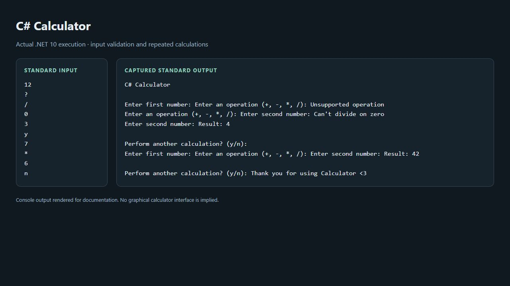

# Calculator

An interactive C# console calculator built with .NET 10.


## Real execution preview

This console application has no graphical interface. The capture below is from an earlier version; current prompts also list the new commands and operations. The image below renders the **actual standard output** from a .NET 10 run beside the supplied input. It demonstrates an invalid operator, division-by-zero recovery, and two calculations.



Raw capture: [input](docs/demo-input.txt) · [output](docs/demo-output.txt).

## Features

- Addition, subtraction, multiplication, division, remainder (`%`), and powers (`^`).
- Reuse the last successful result with `ans` in either number field.
- Inline operator help (`help` or `?`) and early exit (`q` or `quit`).
- Common operator aliases: `x`, `X`, and `×` for multiplication, `÷` for division, and `−` for subtraction.
- Numeric input validation that retries the current field without losing the other operand or operator.
- Division-by-zero protection.
- Multiple calculations in one session.

## Requirements

Install the [.NET 10 SDK](https://dotnet.microsoft.com/download/dotnet/10.0).

## Run locally

```sh
git clone https://github.com/ZiadMaghraby/calculator.git
cd calculator
dotnet run --project CalculatorApp.csproj
```

Enter the first number, an operator (`+`, `-`, `*`, `/`, `%`, or `^`), and the second number when prompted. Enter `y` or `yes` to calculate again, or `n` or `no` to exit. Answers are case-insensitive and surrounding whitespace is ignored. Other continuation answers are retried. You can enter `q` or `quit` at any prompt to exit.

At the operator prompt, enter `help` or `?` to list operations without losing your first number. At either number prompt, `ans` recalls the last successful result in this session. Before any successful calculation, `ans` asks you to enter a number instead. Failed operations leave the previous answer intact.

For example, calculate `2 + 3`, answer `yes`, then calculate `ans ^ 2` to get `25`.

`%` computes a remainder, not a percentage: `17 % 5` is `2`, and `-17 % 5` is `-2`. Both `/` and `%` reject zero divisors. Powers use real-number floating-point arithmetic; `2 ^ -2` is `0.25`, while `-1 ^ 0.5` has no real-number result. Non-real and overflow results print an error and start a new calculation. As with other `double` arithmetic, decimal results may have rounding error.

## Example

```text
C# Calculator
Type q or quit to exit; type help at the operation prompt; use ans for the last result.

Enter first number: 12
Enter an operation (+, -, *, /, %, ^): /
Enter second number: 3
Result: 4

Perform another calculation? (y/n): n
Thank you for using Calculator <3
```

## Input and error handling

| Input | Behavior |
| --- | --- |
| Invalid first or second number | Prints `Invalid number format` and retries that number. |
| Unsupported operator | Prints `Unsupported operation` and retries the operator, preserving the first number. |
| Division by zero | Prints `Can't divide on zero` and retries the divisor. |
| End of input or `q`/`quit` at any prompt | Exits cleanly without looping. |
| Invalid continuation answer | Retries until `y`/`yes`, `n`/`no`, quit, or end of input. |
| Non-real power result | Prints `Operation has no real-number result` and starts a new calculation. |
| Overflow | Prints `Result is outside the supported numeric range` and starts a new calculation. |

Numbers use the system's current culture, so the decimal separator depends on your locale. Thousands/grouping separators are not accepted: enter `1500` rather than `1,500` on an English system. This prevents a misplaced decimal separator such as `1,5` from silently becoming `15`. Signs, surrounding whitespace, and scientific notation such as `1.5e2` remain supported (using your locale's decimal separator).

## Regression checks

Run `dotnet run --project tests/Calculator.Regression.csproj`. The dependency-free harness covers invalid-input recovery, zero divisors, overflow, locale-specific decimals, repeat calculations and EOF at each prompt. It also checks ordered results, stream argument validation, quit commands, help, aliases, remainder, powers, and answer reuse. GitHub Actions builds with warnings treated as errors and runs the harness on Windows and Linux.

## Project structure

- `Program.cs`: interactive input loop, validation, and arithmetic operations.
- `CalculatorApp.csproj`: .NET 10 console application configuration.
